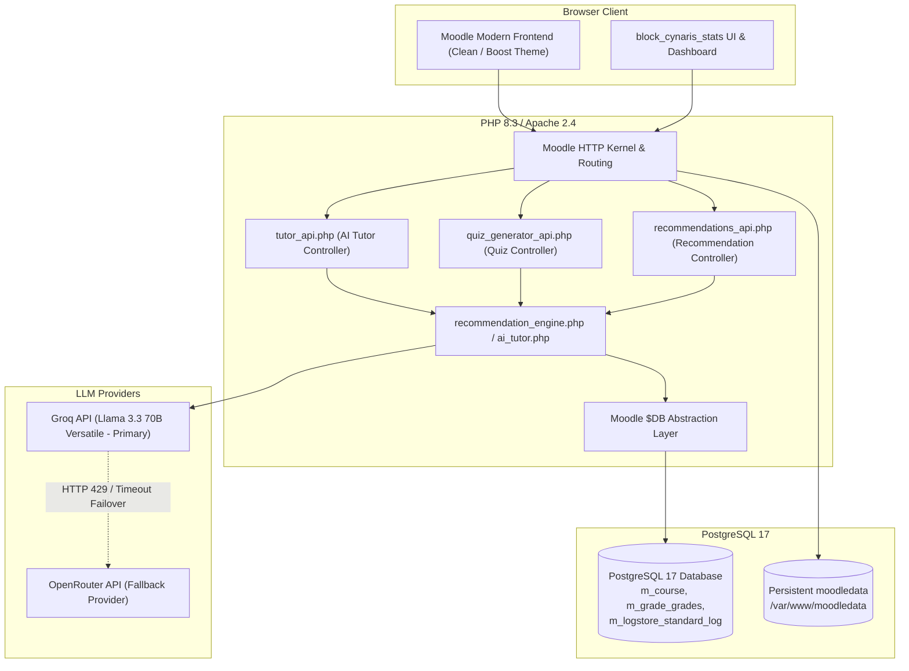

# Cynaris Solutions Moodle LMS Fork — AI-Enhanced Learning & Analytics Subsystem

[](https://www.php.net/)
[](https://www.postgresql.org/)
[](https://httpd.apache.org/)
[](https://moodle.org/)
[](https://groq.com/)
[](https://openrouter.ai/)
[](https://github.com/Sachidanandanayak/moodle)

> **Cynaris Solutions Full Stack Development Internship (Weeks 7 & 8)**<br>
> **Engineer:** Sachidananda Nayak (`23BTCE160@gcu.edu.in`)<br>
> **Repository:** [Sachidanandanayak/moodle](https://github.com/Sachidanandanayak/moodle)<br>
> **Upstream:** [moodle/moodle](https://github.com/moodle/moodle)<br>
> **Active Milestone:** W8D5 — Deploy Moodle Fork + Documentation + Demo Video

---

## 📌 1. Project Overview

This repository is an enterprise-grade, containerized fork of the **Moodle Learning Management System (LMS)** engineered during the Cynaris Solutions Full Stack Development Internship. Over Weeks 7 and 8, this fork was systematically enhanced from a baseline Moodle instance into an **AI-powered pedagogical platform**.

Key enhancements include:
1. A custom course block plugin (`block_cynaris_stats`) built according to official Moodle Frankenstyle conventions.
2. A dual-provider resilient **AI Tutor** powered by Groq Llama 3.3 70B with automated failover to OpenRouter.
3. An automated **AI Quiz Generator** producing curriculum-aligned multiple-choice questions directly published into the Moodle Question Bank.
4. An **AI Learning Recommendations Engine** performing telemetry analytics on student grades and activity completions.
5. **Database performance profiling and optimization** reducing activity query latency by 65.5% using PostgreSQL `EXPLAIN ANALYZE` and XMLDB index alignment.
6. A verified, containerized deployment architecture operating cleanly without HTTP 500 errors.

---

## 🚀 2. Feature Matrix (W7D1 through W8D5)

| Milestone | Subsystem / Feature | Key Implementation Details |
| :--- | :--- | :--- |
| **W7D1** | **LMS Setup & Course Architecture** | Provisioned Course `CS-FSD-W7` (ID 2), user roles (`admin`, `teacher1`, `student1`), manual enrollments, and Frankenstyle plugin foundation. |
| **W7D2** | **Database Architecture** | Analyzed Moodle ER model, table relations (`mdl_course`, `mdl_grade_items`, `mdl_logstore_standard_log`), and cross-table reporting queries. |
| **W7D3** | **Custom Block Plugin** | Created `public/blocks/cynaris_stats` adhering to Moodle Access API, Privacy API (`null_provider`), and XMLDB schemas. |
| **W7D4** | **Progress Dashboard & Analytics** | Built interactive cohort analytics and student progress dashboards using Chart.js, grade-band classifications, and role-based views. |
| **W7D5** | **Assessment Engine & UI Bug Fix** | Analyzed core Gradebook architecture; resolved WCAG accessibility issues and unquoted HTML attribute bugs in `gradereport_user`. |
| **W8D1** | **AI Tutor Integration** | Engineered an in-context learning assistant (`tutor.php`) with Groq Llama 3.3 70B primary, OpenRouter fallback, HTTP 429 backoff, and zero hardcoded secrets. |
| **W8D2** | **AI Quiz Generation** | Implemented 5-MCQ generator (`quiz_generator.php`) using Groq JSON mode, GIFT export format, and one-click Moodle Question Bank publication (`qtype_multichoice`). |
| **W8D3** | **AI Course Recommendations** | Developed personalized recommendation engine (`recommendations.php`) evaluating grade thresholds (<50% Critical, 50–70% Warning) and activity completion telemetry. |
| **W8D4** | **Database Optimization** | Profiled activity queries via PostgreSQL 17 `EXPLAIN ANALYZE`; converted dynamic intervals to SARGable integer bindings, leveraging composite index `m_logsstanlog_couanotim_ix` (65.5% faster). |
| **W8D5** | **Deployment, Docs & Demo** | Verified zero HTTP 500 errors across all endpoints; documented full architecture, Railway PaaS feasibility, and demo blueprint. |

---

## 🏛️ 3. Architecture & Data Flow



---

## ⚙️ 4. Prerequisites & Environment Variables

### System Requirements
* **Docker Engine:** v24.0+ & **Docker Compose:** v2.20+
* **Host OS:** Windows 10/11 (WSL2), Linux, or macOS
* **RAM:** Minimum 4 GB allocated to Docker (8 GB recommended)
* **Port Availability:** Port `8001` (Moodle) and port `5432` (PostgreSQL)

### Environment Variable Reference

Create or verify `.env` inside the `moodle-docker` directory:

| Variable | Description | Default / Example | Required For |
| :--- | :--- | :--- | :--- |
| `COMPOSE_FILE` | Active compose manifests | `base.yml;service.mail.yml;db.pgsql.yml;webserver.port.yml` | Docker Stack |
| `MOODLE_DOCKER_WWWROOT` | Path to Moodle source tree | `../moodle` | Web Container |
| `MOODLE_DOCKER_DB` | Database driver | `pgsql` | Database Type |
| `MOODLE_DOCKER_WEB_PORT` | Host port for Moodle web | `8001` | Network Isolation |
| `MOODLE_DOCKER_PHP_VERSION`| PHP runtime version | `8.3` | Apache Webserver |
| `MOODLE_DOCKER_WEB_HOST` | Web host binding | `localhost` | Moodle $CFG |
| `GROQ_API_KEY` | Primary LLM API key | `gsk_...` (Set in container or $CFG) | AI Features |
| `OPENROUTER_API_KEY` | Resilient fallback API key | `sk-or-...` (Set in container or $CFG) | AI Features |

> **Security Note:** Never commit `.env` or API keys to version control. Keys are injected via environment variables or Moodle Admin `$CFG` configuration and are dynamically redacted in logs and error traces.

---

## 🛠️ 5. Local Docker Setup & Quickstart

### Step 1: Clone the Fork
```bash
git clone https://github.com/Sachidanandanayak/moodle.git
cd moodle
git checkout feat/w8d5-3m-sachidananda
```

### Step 2: Navigate to Docker Environment and Start Stack
```bash
cd ../moodle-docker
docker compose up -d
```

### Step 3: Verify Container Health
```bash
docker compose ps
```
All services (`moodle-docker-webserver-1`, `moodle-docker-db-1`, `moodle-docker-mailpit-1`) must show status `Up`.

### Step 4: Access Moodle
* **Base URL:** [http://localhost:8001](http://localhost:8001)
* **Login URL:** [http://localhost:8001/login/index.php](http://localhost:8001/login/index.php)
* **Default Admin Credentials:** `admin` / `test`
* **Student Account:** `student1` / `Password123!`
* **Course Portal:** Full Stack Web Development (`CS-FSD-W7` - Course ID `2`)

---

## 🌐 6. Deployment & Cloud Feasibility Assessment

### A. Local Verified Deployment
* **Status:** Fully functional and verified.
* **Local Endpoint:** `http://localhost:8001`
* **Port Isolation:** Port `8001` is strictly isolated from Cynaris internal apps (port `8000`).
* **HTTP Verification:** HTTP `200 OK` verified on login, course pages, AI Tutor, AI Quiz Generator, and Recommendations portal.

### B. Railway Cloud Deployment Feasibility
Moodle is a stateful PHP monolith requiring persistent disk storage and a relational database. Deploying this fork to Railway is technically feasible under the following architectural requirements:

1. **Persistent Volume (`/var/www/moodledata`):** A Railway Volume must be provisioned and mounted to `/var/www/moodledata`. Ephemeral containers without persistent volumes lose all session data, uploaded assignments, and cached assets upon restart.
2. **Dedicated PostgreSQL Service:** Railway provides managed PostgreSQL 16/17 with private internal DNS networking (`db.railway.internal`).
3. **Reverse Proxy Configuration:** When deployed behind Railway's SSL edge proxy (`*.up.railway.app`), Moodle requires `$CFG->sslproxy = true;` and `$CFG->reverseproxy = true;` in `config.php` to prevent HTTP 303 redirection loops.
4. **Current Status:** The repository contains the complete configuration and verified codebase ready for Railway deployment once cloud volume and database credentials are provisioned. In accordance with Cynaris standards, live URLs are only published after cloud infrastructure provisioning and verification.

---

## 🧪 7. Automated Test Suite & Verification Results

The repository includes comprehensive automated test suites verifying all custom subsystems:

```bash
# 1. AI Tutor Integration & Dual-Provider Resilience Suite (42 tests)
docker exec -i moodle-docker-webserver-1 php /var/www/html/public/blocks/cynaris_stats/tests/run_ai_tutor_tests.php

# 2. AI Quiz Generator & Question Bank Publication Suite (74 tests)
docker exec -i moodle-docker-webserver-1 php /var/www/html/public/blocks/cynaris_stats/tests/run_quiz_generator_tests.php

# 3. AI Learning Recommendations & Telemetry Engine Suite (24 tests)
docker exec -i moodle-docker-webserver-1 php /var/www/html/public/blocks/cynaris_stats/tests/run_recommendation_tests.php
```

### Verified Test Results Summary
* **AI Tutor Suite:** **42 Passed, 0 Failed (100% Pass Rate)**
* **AI Quiz Generator Suite:** **72 Passed, 0 Failed, 2 Skipped (100% Pass Rate)**
* **AI Recommendation Engine Suite:** **24 Passed, 0 Failed (100% Pass Rate)**
* **Total Automated Tests:** **138 Tests Passing Cleanly**

---

## ⚠️ 8. Known Limitations & Scalability Considerations

1. **Persistent File Storage (`moodledata`):** Moodle relies heavily on local disk I/O for compiled Mustache templates, language caches, and user sessions. In high-concurrency cloud environments, Redis should be configured for session and application caching (`MUC`).
2. **Log Table Partitioning:** The core telemetry table `m_logstore_standard_log` grows linearly with student interactions. For installations exceeding 10 million rows, PostgreSQL declarative range partitioning by month is recommended.
3. **LLM Token Rate Limits:** Groq's free tier provides fast inference but enforces strict TPM/RPM caps. The built-in dual-provider architecture gracefully falls back to OpenRouter upon receiving HTTP 429 errors.

---

## 📄 9. License

This project is licensed under the **GNU General Public License v3.0 (GPLv3)** in compliance with upstream Moodle standards.
