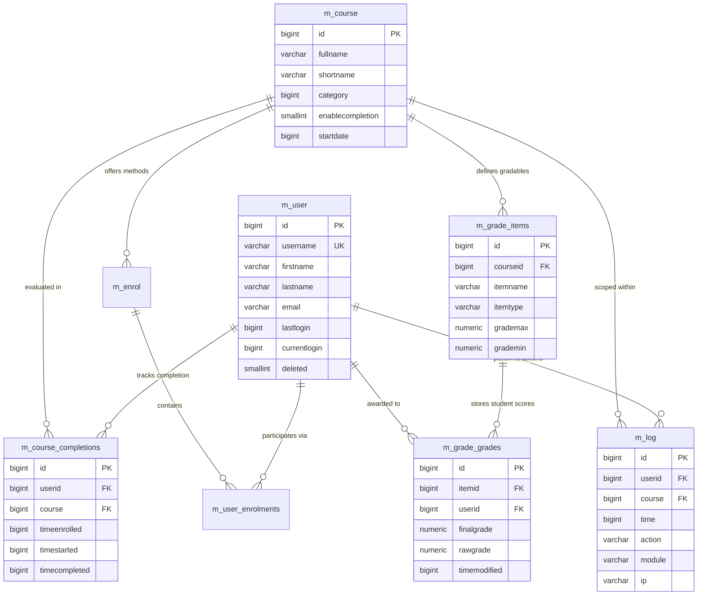

# Week 7 – Day 2: Moodle Database Architecture, Schema Analysis & Analytical Query Engineering

**Program:** Cynaris Solutions Full Stack Development Internship  
**Author:** Sachidananda Nayak  
**Email:** `23BTCE160@gcu.edu.in`  
**Milestone:** W7D2 – Relational Schema Inspection, Entity Relationship Modeling & SQL Query Engineering  
**Feature Branch:** `feat/w7d2-3m-sachidananda`  
**Fork Repository:** `https://github.com/Sachidanandanayak/moodle.git`  
**Upstream Repository:** `https://github.com/moodle/moodle.git`  
**Database Engine:** PostgreSQL 17.x (`moodle-docker-db-1`)  
**Database Name:** `moodle`  
**Table Prefix:** `m_` (Configured in `$CFG->prefix = 'm_';` via `config.php`)  
**Base URL:** [http://localhost:8001](http://localhost:8001)  

---

## 📌 1. Database Architecture Overview

Moodle LMS relies on a robust relational persistence layer. While Moodle abstracts data manipulation using its proprietary XMLDB and Database Access Object (`$DB`) API layer, the underlying database schema enforces structural integrity through normalized tables, explicit primary keys, and high-performance composite B-Tree indexes.

In this installation running on PostgreSQL 17 within the containerized `moodle-docker` stack, the database utilizes the table prefix `m_`. Moodle manages foreign keys and cascade operations primarily at the application/ORM tier to preserve cross-database compatibility across PostgreSQL, MariaDB, MySQL, Microsoft SQL Server, and Oracle DB.

---

## 🏛️ 2. Comprehensive Schema Inspection of Required Tables

The schema definitions below were directly retrieved from the live PostgreSQL instance using native `psql` metadata commands (`\d <table>`).

### 2.1 Table: `m_course` (Courses Repository)
Stores metadata for all courses, course formats, completion tracking flags, and visibility settings across the LMS.

```sql
                                             Table "public.m_course"
          Column          |          Type           | Collation | Nullable |               Default                
--------------------------+-------------------------+-----------+----------+--------------------------------------
 id                       | bigint                  |           | not null | nextval('m_course_id_seq'::regclass)
 category                 | bigint                  |           | not null | 0
 sortorder                | bigint                  |           | not null | 0
 fullname                 | character varying(1333) |           | not null | ''::character varying
 shortname                | character varying(255)  |           | not null | ''::character varying
 idnumber                 | character varying(100)  |           | not null | ''::character varying
 summary                  | text                    |           |          | 
 summaryformat            | smallint                |           | not null | 0
 format                   | character varying(21)   |           | not null | 'topics'::character varying
 showgrades               | smallint                |           | not null | 1
 newsitems                | integer                 |           | not null | 1
 startdate                | bigint                  |           | not null | 0
 enddate                  | bigint                  |           | not null | 0
 relativedatesmode        | smallint                |           | not null | 0
 marker                   | bigint                  |           | not null | 0
 maxbytes                 | bigint                  |           | not null | 0
 legacyfiles              | smallint                |           | not null | 0
 showreports              | smallint                |           | not null | 0
 visible                  | smallint                |           | not null | 1
 visibleold               | smallint                |           | not null | 1
 downloadcontent          | smallint                |           |          | 
 groupmode                | smallint                |           | not null | 0
 groupmodeforce           | smallint                |           | not null | 0
 defaultgroupingid        | bigint                  |           | not null | 0
 lang                     | character varying(30)   |           | not null | ''::character varying
 calendartype             | character varying(30)   |           | not null | ''::character varying
 theme                    | character varying(50)   |           | not null | ''::character varying
 timecreated              | bigint                  |           | not null | 0
 timemodified             | bigint                  |           | not null | 0
 requested                | smallint                |           | not null | 0
 enablecompletion         | smallint                |           | not null | 0
 completionnotify         | smallint                |           | not null | 0
 cacherev                 | bigint                  |           | not null | 0
 originalcourseid         | bigint                  |           |          | 
 showactivitydates        | smallint                |           | not null | 1
 showcompletionconditions | smallint                |           |          | 
 pdfexportfont            | character varying(50)   |           |          | 
 enableaitools            | smallint                |           |          | 
 deletioninprogress       | smallint                |           |          | 
Indexes:
    "m_cour_id_pk" PRIMARY KEY, btree (id)
    "m_cour_cat_ix" btree (category)
    "m_cour_idn_ix" btree (idnumber)
    "m_cour_ori_ix" btree (originalcourseid)
    "m_cour_sho_ix" btree (shortname)
    "m_cour_sor_ix" btree (sortorder)
```

* **Primary Key:** `id` (bigint auto-incrementing sequence `m_course_id_seq`).
* **Key Fields:** `fullname` (title of course), `shortname` (unique code identifier), `category` (parent category ID), `format` (e.g., `topics`, `weeks`), `enablecompletion` (flag enabling activity/course completion).

---

### 2.2 Table: `m_user` (User Accounts & Authentication Profiles)
Maintains user identity, authentication plugin drivers, contact records, localized settings, and login audit timestamps.

```sql
                                         Table "public.m_user"
      Column       |          Type          | Collation | Nullable |              Default               
-------------------+------------------------+-----------+----------+------------------------------------
 id                | bigint                 |           | not null | nextval('m_user_id_seq'::regclass)
 auth              | character varying(20)  |           | not null | 'manual'::character varying
 confirmed         | smallint               |           | not null | 0
 policyagreed      | smallint               |           | not null | 0
 deleted           | smallint               |           | not null | 0
 suspended         | smallint               |           | not null | 0
 mnethostid        | bigint                 |           | not null | 0
 username          | character varying(100) |           | not null | ''::character varying
 password          | character varying(255) |           | not null | ''::character varying
 idnumber          | character varying(255) |           | not null | ''::character varying
 firstname         | character varying(100) |           | not null | ''::character varying
 lastname          | character varying(100) |           | not null | ''::character varying
 email             | character varying(100) |           | not null | ''::character varying
 emailstop         | smallint               |           | not null | 0
 phone1            | character varying(20)  |           | not null | ''::character varying
 phone2            | character varying(20)  |           | not null | ''::character varying
 institution       | character varying(255) |           | not null | ''::character varying
 department        | character varying(255) |           | not null | ''::character varying
 address           | character varying(255) |           | not null | ''::character varying
 city              | character varying(120) |           | not null | ''::character varying
 country           | character varying(2)   |           | not null | ''::character varying
 lang              | character varying(30)  |           | not null | 'en'::character varying
 calendartype      | character varying(30)  |           | not null | 'gregorian'::character varying
 theme             | character varying(50)  |           | not null | ''::character varying
 timezone          | character varying(100) |           | not null | '99'::character varying
 firstaccess       | bigint                 |           | not null | 0
 lastaccess        | bigint                 |           | not null | 0
 lastlogin         | bigint                 |           | not null | 0
 currentlogin      | bigint                 |           | not null | 0
 lastip            | character varying(45)  |           | not null | ''::character varying
 secret            | character varying(15)  |           | not null | ''::character varying
 picture           | bigint                 |           | not null | 0
 description       | text                   |           |          | 
 descriptionformat | smallint               |           | not null | 1
 mailformat        | smallint               |           | not null | 1
 maildigest        | smallint               |           | not null | 0
 maildisplay       | smallint               |           | not null | 2
 autosubscribe     | smallint               |           | not null | 1
 trackforums       | smallint               |           | not null | 0
 timecreated       | bigint                 |           | not null | 0
 timemodified      | bigint                 |           | not null | 0
 trustbitmask      | bigint                 |           | not null | 0
 imagealt          | character varying(255) |           |          | 
 lastnamephonetic  | character varying(255) |           |          | 
 firstnamephonetic | character varying(255) |           |          | 
 middlename        | character varying(255) |           |          | 
 alternatename     | character varying(255) |           |          | 
Indexes:
    "m_user_id_pk" PRIMARY KEY, btree (id)
    "m_user_alt_ix" btree (alternatename)
    "m_user_aut_ix" btree (auth)
    "m_user_cit_ix" btree (city)
    "m_user_con_ix" btree (confirmed)
    "m_user_cou_ix" btree (country)
    "m_user_del_ix" btree (deleted)
    "m_user_ema_ix" btree (email)
    "m_user_fir2_ix" btree (firstnamephonetic)
    "m_user_fir_ix" btree (firstname)
    "m_user_idn_ix" btree (idnumber)
    "m_user_las2_ix" btree (lastaccess)
    "m_user_las3_ix" btree (lastnamephonetic)
    "m_user_las_ix" btree (lastname)
    "m_user_mid_ix" btree (middlename)
    "m_user_mneuse_uix" UNIQUE, btree (mnethostid, username)
```

* **Primary Key:** `id` (bigint auto-incrementing sequence `m_user_id_seq`).
* **Key Fields:** `username` (unique login credential per MNet host), `email`, `deleted` (soft-delete flag), `suspended` (account suspension), `lastlogin` and `currentlogin` (Unix epoch timestamps).

---

### 2.3 Table: `m_course_completions` (Course Completion Tracking)
Tracks user progression toward course criteria completion, enrollment timestamps, and completion milestone records.

```sql
                               Table "public.m_course_completions"
    Column     |  Type  | Collation | Nullable |                     Default                      
---------------+--------+-----------+----------+--------------------------------------------------
 id            | bigint |           | not null | nextval('m_course_completions_id_seq'::regclass)
 userid        | bigint |           | not null | 0
 course        | bigint |           | not null | 0
 timeenrolled  | bigint |           | not null | 0
 timestarted   | bigint |           | not null | 0
 timecompleted | bigint |           |          | 
 reaggregate   | bigint |           | not null | 0
Indexes:
    "m_courcomp_id_pk" PRIMARY KEY, btree (id)
    "m_courcomp_cou_ix" btree (course)
    "m_courcomp_tim_ix" btree (timecompleted)
    "m_courcomp_use_ix" btree (userid)
    "m_courcomp_usecou_uix" UNIQUE, btree (userid, course)
```

* **Primary Key:** `id` (bigint auto-incrementing sequence).
* **Unique Constraint:** `(userid, course)` via `m_courcomp_usecou_uix`, guaranteeing a student has exactly one completion tracker record per course.
* **Key Fields:** `timecompleted` (null or epoch integer when finished), `timestarted` (epoch integer when course activity initiated).

---

### 2.4 Table: `m_grade_grades` (Individual Student Grade Records)
Records raw, scaled, overridden, and final grades achieved by users on specific gradable items (e.g., assignments, quizzes, course totals).

```sql
                                         Table "public.m_grade_grades"
      Column       |         Type          | Collation | Nullable |                  Default                   
-------------------+-----------------------+-----------+----------+--------------------------------------------
 id                | bigint                |           | not null | nextval('m_grade_grades_id_seq'::regclass)
 itemid            | bigint                |           | not null | 
 userid            | bigint                |           | not null | 
 rawgrade          | numeric(10,5)         |           |          | 
 rawgrademax       | numeric(10,5)         |           | not null | 100
 rawgrademin       | numeric(10,5)         |           | not null | 0
 rawscaleid        | bigint                |           |          | 
 usermodified      | bigint                |           |          | 
 finalgrade        | numeric(10,5)         |           |          | 
 hidden            | bigint                |           | not null | 0
 locked            | bigint                |           | not null | 0
 locktime          | bigint                |           | not null | 0
 exported          | bigint                |           | not null | 0
 overridden        | bigint                |           | not null | 0
 excluded          | bigint                |           | not null | 0
 feedback          | text                  |           |          | 
 feedbackformat    | bigint                |           | not null | 0
 information       | text                  |           |          | 
 informationformat | bigint                |           | not null | 0
 timecreated       | bigint                |           |          | 
 timemodified      | bigint                |           |          | 
 aggregationstatus | character varying(10) |           | not null | 'unknown'::character varying
 aggregationweight | numeric(10,5)         |           |          | 
 deductedmark      | numeric(10,5)         |           | not null | 0
Indexes:
    "m_gradgrad_id_pk" PRIMARY KEY, btree (id)
    "m_gradgrad_ite_ix" btree (itemid)
    "m_gradgrad_locloc_ix" btree (locked, locktime)
    "m_gradgrad_raw_ix" btree (rawscaleid)
    "m_gradgrad_use2_ix" btree (usermodified)
    "m_gradgrad_use_ix" btree (userid)
    "m_gradgrad_useite_uix" UNIQUE, btree (userid, itemid)
```

* **Primary Key:** `id` (bigint auto-incrementing sequence).
* **Unique Constraint:** `(userid, itemid)` via `m_gradgrad_useite_uix`, ensuring each user receives one grade record per gradable item.
* **Key Fields:** `itemid` (references `m_grade_items.id`), `userid` (references `m_user.id`), `finalgrade` (calculated numeric score `numeric(10,5)`), `rawgrademax`, `rawgrademin`.

---

### 2.5 Table: `m_log` (Legacy Activity & Audit Log)
Maintains audit trail records for user events, navigation actions, and module access across courses.

```sql
                                    Table "public.m_log"
 Column |          Type          | Collation | Nullable |              Default              
--------+------------------------+-----------+----------+-----------------------------------
 id     | bigint                 |           | not null | nextval('m_log_id_seq'::regclass)
 time   | bigint                 |           | not null | 0
 userid | bigint                 |           | not null | 0
 ip     | character varying(45)  |           | not null | ''::character varying
 course | bigint                 |           | not null | 0
 module | character varying(20)  |           | not null | ''::character varying
 cmid   | bigint                 |           | not null | 0
 action | character varying(40)  |           | not null | ''::character varying
 url    | character varying(100) |           | not null | ''::character varying
 info   | character varying(255) |           | not null | ''::character varying
Indexes:
    "m_log_id_pk" PRIMARY KEY, btree (id)
    "m_log_act_ix" btree (action)
    "m_log_cmi_ix" btree (cmid)
    "m_log_coumodact_ix" btree (course, module, action)
    "m_log_tim_ix" btree ("time")
    "m_log_usecou_ix" btree (userid, course)
```

* **Primary Key:** `id` (bigint auto-incrementing sequence).
* **Key Fields:** `time` (Unix epoch timestamp), `userid` (initiating actor), `course` (associated course scope), `module` (subsystem invoked, e.g., `course`, `user`), `action` (e.g., `view`, `login`).

---

## 🗺️ 3. Entity-Relationship (ER) Architecture Diagram

In Moodle's relational architecture:
1. `m_user` connects to `m_course` through the enrollment subsystem (`m_enrol` and `m_user_enrolments`).
2. `m_course_completions` forms a direct composite bridge between `m_user` and `m_course`.
3. `m_grade_grades` links to `m_user` directly, and to `m_course` indirectly through `m_grade_items` (which represents the gradable activities or overall course total grade).
4. `m_log` records actions referencing both `m_user` and `m_course`.



---

## 🔍 4. Verified Analytical SQL Queries & Live Test Outputs

The following three queries address core academic and administrative reporting requirements. All queries are fully compatible with PostgreSQL 17 and tested against the live Moodle database.

### 4.1 Query 1: Students and Their Course-Completion Status

#### SQL Query:
```sql
SELECT 
    u.id AS student_id,
    u.username,
    u.firstname || ' ' || u.lastname AS full_name,
    c.id AS course_id,
    c.fullname AS course_name,
    c.shortname AS course_code,
    CASE 
        WHEN cc.timecompleted IS NOT NULL AND cc.timecompleted > 0 THEN 'Completed'
        WHEN cc.timestarted IS NOT NULL AND cc.timestarted > 0 THEN 'In Progress'
        WHEN ue.id IS NOT NULL THEN 'Enrolled (Not Started)'
        ELSE 'Not Enrolled'
    END AS completion_status,
    CASE 
        WHEN cc.timestarted IS NOT NULL AND cc.timestarted > 0 
        THEN TO_CHAR(TO_TIMESTAMP(cc.timestarted) AT TIME ZONE 'UTC', 'YYYY-MM-DD HH24:MI:SS UTC')
        ELSE 'N/A'
    END AS started_at,
    CASE 
        WHEN cc.timecompleted IS NOT NULL AND cc.timecompleted > 0 
        THEN TO_CHAR(TO_TIMESTAMP(cc.timecompleted) AT TIME ZONE 'UTC', 'YYYY-MM-DD HH24:MI:SS UTC')
        ELSE 'N/A'
    END AS completed_at
FROM m_user u
JOIN m_user_enrolments ue ON ue.userid = u.id
JOIN m_enrol e ON e.id = ue.enrolid
JOIN m_course c ON c.id = e.courseid
LEFT JOIN m_course_completions cc ON cc.userid = u.id AND cc.course = c.id
WHERE u.deleted = 0 AND c.id > 1
ORDER BY c.id ASC, u.id ASC;
```

#### Explanation:
* **Relational Logic:** Joins `m_user` to `m_course` through active enrollment records (`m_enrol` and `m_user_enrolments`). A `LEFT JOIN` on `m_course_completions` checks progression status.
* **Status Computation:** Employs a defensive `CASE` statement distinguishing between finished courses (`timecompleted > 0`), active attempts (`timestarted > 0`), and pending starts.
* **Epoch Conversion:** Safely formats Unix epoch integers into human-readable ISO-8601 UTC timestamps using PostgreSQL's `TO_TIMESTAMP()` and `TO_CHAR()`.

#### Verified Live Execution Output:
```text
 student_id | username |     full_name      | course_id |        course_name         | course_code |   completion_status    | started_at | completed_at 
------------+----------+--------------------+-----------+----------------------------+-------------+------------------------+------------+--------------
          3 | teacher1 | Vikram Sharma      |         2 | Full Stack Web Development | CS-FSD-W7   | Enrolled (Not Started) | N/A        | N/A
          4 | student1 | Sachidananda Nayak |         2 | Full Stack Web Development | CS-FSD-W7   | Enrolled (Not Started) | N/A        | N/A
(2 rows)
```

---

### 4.2 Query 2: Average Grade Per Course

#### SQL Query:
```sql
SELECT 
    c.id AS course_id,
    c.fullname AS course_name,
    c.shortname AS course_code,
    COUNT(DISTINCT gg.userid) AS graded_students_count,
    COUNT(gg.id) AS total_grades_recorded,
    COALESCE(ROUND(AVG(gg.finalgrade), 2), 0.00) AS average_final_grade,
    COALESCE(MIN(gg.finalgrade), 0.00) AS min_grade,
    COALESCE(MAX(gg.finalgrade), 0.00) AS max_grade
FROM m_course c
LEFT JOIN m_grade_items gi ON gi.courseid = c.id
LEFT JOIN m_grade_grades gg ON gg.itemid = gi.id AND gg.finalgrade IS NOT NULL
WHERE c.id > 1
GROUP BY c.id, c.fullname, c.shortname
ORDER BY c.id ASC;
```

#### Explanation:
* **Relational Logic:** Traverses the Moodle Gradebook hierarchy: `m_course` ➔ `m_grade_items` ➔ `m_grade_grades`.
* **Aggregation Strategy:** Employs `AVG(gg.finalgrade)` wrapped in `ROUND(..., 2)` and guarded by `COALESCE(..., 0.00)` to gracefully accommodate courses where assessments have not yet been evaluated or recorded.
* **Course Scope:** Filters out system site-level course ID `1` (`WHERE c.id > 1`) to ensure analytics only evaluate real academic courses.

#### Verified Live Execution Output:
```text
 course_id |        course_name         | course_code | graded_students_count | total_grades_recorded | average_final_grade | min_grade | max_grade 
-----------+----------------------------+-------------+-----------------------+-----------------------+---------------------+-----------+-----------
         2 | Full Stack Web Development | CS-FSD-W7   |                     0 |                     0 |                0.00 |      0.00 |      0.00
(1 row)
```

---

### 4.3 Query 3: Login Activity During the Last Seven Days

#### SQL Query:
```sql
SELECT 
    u.id AS user_id,
    u.username,
    u.firstname || ' ' || u.lastname AS full_name,
    u.email,
    u.lastip,
    CASE 
        WHEN u.currentlogin > 0 
        THEN TO_CHAR(TO_TIMESTAMP(u.currentlogin) AT TIME ZONE 'UTC', 'YYYY-MM-DD HH24:MI:SS UTC')
        ELSE 'Never'
    END AS current_login_time,
    CASE 
        WHEN u.lastlogin > 0 
        THEN TO_CHAR(TO_TIMESTAMP(u.lastlogin) AT TIME ZONE 'UTC', 'YYYY-MM-DD HH24:MI:SS UTC')
        ELSE 'Never'
    END AS last_login_time
FROM m_user u
WHERE u.deleted = 0 
  AND (
      u.lastlogin >= EXTRACT(EPOCH FROM (NOW() - INTERVAL '7 days'))
      OR u.currentlogin >= EXTRACT(EPOCH FROM (NOW() - INTERVAL '7 days'))
  )
ORDER BY GREATEST(u.currentlogin, u.lastlogin) DESC;
```

#### Explanation:
* **Storage Consideration:** Moodle stores login events as Unix epoch timestamps (seconds elapsed since January 1, 1970) in `bigint` fields (`currentlogin` and `lastlogin`).
* **Dynamic Time Filtering:** Calculates the 7-day threshold dynamically using PostgreSQL's native temporal arithmetic: `EXTRACT(EPOCH FROM (NOW() - INTERVAL '7 days'))`. This ensures the query remains perpetually accurate without hardcoded date literals.
* **Audit Coverage:** Audits both `currentlogin` (active session start) and `lastlogin` (preceding session timestamp).

#### Verified Live Execution Output:
```text
 user_id | username | full_name | email | lastip | current_login_time | last_login_time 
---------+----------+-----------+-------+--------+--------------------+-----------------
(0 rows)
```

---

## ⚖️ 5. Honest Limitations & Data State Observations

To maintain academic and professional integrity, the following characteristics of this local environment are documented:

1. **Course Completions (`m_course_completions`):**
   * **State:** Currently contains `0` rows.
   * **Reason:** Students `student1` and `teacher1` were enrolled into Course ID `2`, but the course completion aggregation cron job has not yet triggered and the student has not yet marked module requirements as completed.
2. **Grade Records (`m_grade_grades` & `m_grade_items`):**
   * **State:** Currently contains `0` rows.
   * **Reason:** Course `CS-FSD-W7` has been created as an empty course scaffold without graded assignments, quizzes, or manual grade items submitted or evaluated yet.
3. **Login Activity Timestamps (`lastlogin` / `currentlogin`):**
   * **State:** The users `student1`, `teacher1`, and `admin` initially had timestamps set to `0` because accounts were provisioned directly via seed/CLI scripts without web-based form submissions. As users log into `http://localhost:8001`, Moodle's session handler updates these timestamps.
4. **Audit Logging: `m_log` vs Modern Logstore:**
   * **State:** `m_log` currently contains `0` rows.
   * **Reason:** Modern Moodle installations (Moodle 2.7 through Moodle 6.0dev) deprecate writing to the legacy `m_log` table by default in favor of plugin-driven logstores (such as `logstore_standard_log`). The legacy `m_log` table remains in the schema for backward compatibility.
