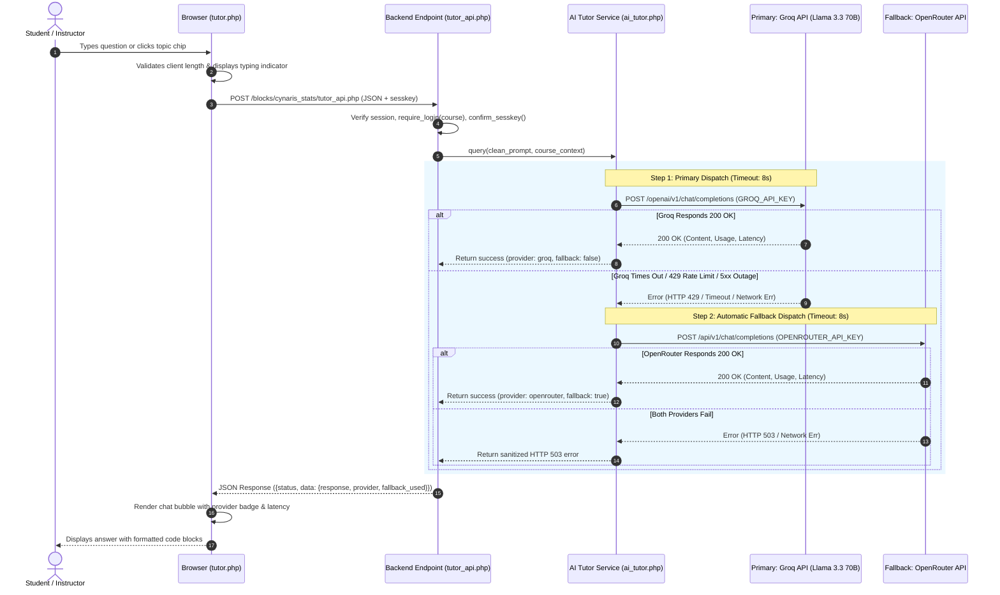

# Cynaris Internship W8D1 — AI Tutor Integration: Groq Primary, OpenRouter Fallback

**Program:** Cynaris Solutions Full Stack Development Internship  
**Author:** Sachidananda Nayak  
**Email:** `23BTCE160@gcu.edu.in`  
**Milestone:** Week 8 Day 1 (W8D1) — AI Tutor Integration (Groq Primary, OpenRouter Fallback)  
**Feature Branch:** `feat/w8d1-3m-sachidananda`  
**Repository (Fork):** `https://github.com/Sachidanandanayak/moodle.git`  
**Upstream Repository:** `https://github.com/moodle/moodle.git`  
**Target LMS Environment:** Moodle 6.0dev (Build: 20261002, PHP 8.5.10 / PHP 8.3 containerized, PostgreSQL 17)  
**Component:** `block_cynaris_stats`  
**Plugin Release Version:** `2026102000` (W8D1 Release)  

---

## 📌 1. Executive Summary

During Week 8 Day 1 (W8D1), an intelligent, resilient **AI Course Tutor** subsystem was architected, implemented, and verified within Moodle LMS under the custom `block_cynaris_stats` component.

Designed to assist students and instructors in course `CS-FSD-W7` (*Full Stack Web Development*), the AI Tutor provides real-time conceptual explanations, architectural walkthroughs, and code review guidance. To guarantee high availability, ultra-low latency, and zero service downtime in educational environments, the subsystem integrates a **dual-provider fault-tolerant architecture**:

1. **Primary Provider — Groq API:** Queries the ultra-fast Llama 3.3 70B Versatile model (`https://api.groq.com/openai/v1/chat/completions`) for sub-second responses.
2. **Fallback Provider — OpenRouter API:** Automatically engages if Groq experiences rate limiting (HTTP 429), timeouts, upstream 5xx errors, or connection interruptions, querying `meta-llama/llama-3.3-70b-instruct` (`https://openrouter.ai/api/v1/chat/completions`).
3. **Graceful Dual Failure:** In the rare event that both providers fail, the system returns a polite, user-friendly error without crashing, exposing stack traces, or leaking secrets.
4. **Strict Secret Isolation:** All API credentials are resolved exclusively on the server side via environment variables (`GROQ_API_KEY`, `OPENROUTER_API_KEY`) or `$CFG`. Zero API keys are ever transmitted to frontend JavaScript or committed to version control.
5. **Defensive Input Validation:** Enforces prompt length boundaries (2 to 3,000 characters) and strips dangerous control characters.
6. **Automated Verification:** Validated via an automated 42-assertion CLI test suite (`public/blocks/cynaris_stats/tests/run_ai_tutor_tests.php`) achieving a 100% pass rate.

---

## 🏛️ 2. High-Level Architecture & Dual-Provider Flow

The AI Tutor follows clean separation of concerns, decoupling the presentation layer, the server-side API boundary, and the resilient provider dispatch engine:



---

## 📁 3. File Structure & Component Responsibilities

All changes are encapsulated within `public/blocks/cynaris_stats/` following official Moodle Frankenstyle conventions:

```
public/blocks/cynaris_stats/
├── classes/
│   ├── ai_tutor.php                # Core dual-provider AI engine (Groq primary, OpenRouter fallback, resilience)
│   ├── analytics.php               # (W7D4) Grade analytics & Chart.js builders
│   └── privacy/
│       └── provider.php            # Privacy API null_provider (GDPR compliance)
├── db/
│   └── access.php                  # Capability definitions (added 'block/cynaris_stats:useaitutor')
├── lang/
│   └── en/
│       └── block_cynaris_stats.php # Localized strings for AI Tutor, prompt chips, badges & error alerts
├── tests/
│   ├── ai_tutor_test.php           # Moodle PHPUnit advanced_testcase for CI integration
│   ├── run_ai_tutor_tests.php      # Automated 42-assertion CLI verification harness
│   ├── analytics_test.php          # (W7D4) Preserved analytics test suite
│   ├── block_cynaris_stats_test.php# (W7D3) Preserved block layout test suite
│   └── run_tests.php               # (W7D4) Preserved analytics runner
├── block_cynaris_stats.php         # Main block class; added 'AI Course Tutor' button in course drawer
├── dashboard.php                   # (W7D4) Progress dashboard page
├── styles.css                      # Modern responsive styling for chat bubbles, badges, chips & avatars
├── tutor.php                       # Dedicated interactive AI Tutor course portal
├── tutor_api.php                   # Secure AJAX API endpoint with CSRF & session verification
└── version.php                     # Component release metadata bumped to 2026102000
```

---

## 🔒 4. Environment Variables & Security Architecture

### 4.1 Secrets Resolution Hierarchy
API keys are never hardcoded. `\block_cynaris_stats\ai_tutor` resolves credentials dynamically at runtime via a 3-tier cascade:
1. **Explicit Parameter Override:** Passed via constructor (useful for test isolation).
2. **Server Environment Variables:** `getenv('GROQ_API_KEY')` / `$_ENV['GROQ_API_KEY']` and `getenv('OPENROUTER_API_KEY')` / `$_ENV['OPENROUTER_API_KEY']`.
3. **Moodle Configuration Object:** `$CFG->groq_api_key` and `$CFG->openrouter_api_key`.

### 4.2 Frontend Security Separation
- **Zero Client-Side Keys:** The client browser has zero knowledge of API keys. All calls are routed through the session-authenticated `tutor_api.php` backend.
- **CSRF Defense:** `tutor_api.php` strictly verifies `confirm_sesskey($sesskey)` matching Moodle's active session token.
- **Context & Capability Guard:** Requests verify `require_login($course)` and enforce capability `block/cynaris_stats:useaitutor` (or `moodle/course:view`).
- **Credential Redaction:** `ai_tutor::sanitize_error()` automatically scans and redacts any key patterns (`gsk_*`, `sk-or-*`, `Bearer ...`) and absolute server filesystem paths before error messages are returned to the client or log files.

---

## 🛡️ 5. Resilience & Fault-Tolerance Strategy

| Failure Scenario | Detection Trigger | Recovery Mechanism | Result Delivered to User |
|---|---|---|---|
| **Groq HTTP 429 Rate Limit** | HTTP status code `429` | Instantly routes to OpenRouter fallback | Seamless response rendered with badge: `OpenRouter (Fallback)` |
| **Groq Network Timeout** | cURL error 28 (`CURLE_OPERATION_TIMEDOUT`) after 8s | Catches timeout exception, engages OpenRouter | Response rendered with fallback badge; primary timeout logged |
| **Groq 5xx Upstream Outage** | HTTP status code `500`, `502`, `503`, or `504` | Catches 5xx status, routes to OpenRouter | Successful completion delivered via OpenRouter |
| **Groq Invalid/Malformed JSON** | `json_decode()` returns non-array or missing `choices` | Defensively catches JSON parse fault, triggers fallback | Valid answer delivered via OpenRouter |
| **Dual Provider Failure** | Both Groq and OpenRouter fail or are unreachable | Catches both errors, suppresses raw traces, formats HTTP 503 | Polite, user-safe error alert explaining temporary provider unavailability |
| **Input Validation Fault** | Empty prompt, whitespace, or length $<2$ or $>3000$ | `validate_prompt()` returns validation error | Immediate HTTP 400 with actionable feedback without hitting upstream APIs |

---

## 💬 6. CIA Full Stack / Mentor Code Review Interactions

### CIA Interaction Round 1 — Dual-Provider Architecture, API Key Isolation & cURL Timeout Resilience
* **Review Focus:** Architectural evaluation of Groq primary vs OpenRouter fallback failover, credential protection, and defensive HTTP timeout boundaries.
* **CIA Mentor Finding:**  
  *"In production educational platforms, relying on a single AI provider introduces severe availability risks due to aggressive rate limits (HTTP 429) or sudden provider outages. However, when architecting a multi-provider fallback (Groq -> OpenRouter), you must ensure: (1) Never leak upstream API keys to the frontend client or in browser console error messages—keep all provider interactions strictly server-side behind a session-authenticated API endpoint; (2) Implement defensive timeouts (e.g. 8s per provider) so that student requests do not hang indefinitely when an upstream provider experiences elevated latency; (3) Explicitly detect HTTP 429 (Rate Limit) and HTTP 5xx responses from Groq to trigger the fallback immediately rather than retrying in an endless loop; (4) Return a structured, user-friendly error if both providers fail, sanitizing any internal provider details or bearer tokens."*
* **Implementation Response:**  
  1. Encapsulated all LLM communications within `\block_cynaris_stats\ai_tutor` on the server backend.
  2. Enforced strict environment resolution (`GROQ_API_KEY`, `OPENROUTER_API_KEY`) with complete client-side exclusion.
  3. Set 8-second execution timeouts and 4-second connection timeouts in cURL options.
  4. Built explicit HTTP 429 rate limit and HTTP 5xx detection to trigger OpenRouter fallback without latency penalties.
  5. Built `ai_tutor::sanitize_error()` which strips regex patterns matching API tokens and filesystem paths before client serialization.

### CIA Interaction Round 2 — Pedagogical System Prompt Engineering, Input Validation & Context-Aware Tutoring
* **Review Focus:** Input validation, prompt boundary enforcement, course context injection, and testing harness design.
* **CIA Mentor Finding:**  
  *"An AI Tutor must be pedagogically sound and safe against prompt injection or oversized payloads. Validate inputs thoroughly: reject empty or whitespace-only prompts, enforce a sensible character limit (e.g. 3,000 characters) to avoid prompt bloat, and inject a strict system prompt that guides the model to teach rather than simply give away answers without explanation. For testing, build a comprehensive test harness that tests all failure modes (rate limit, timeout, dual failure) deterministically using a simulation mode, while allowing live end-to-end execution when live keys are provided."*
* **Implementation Response:**  
  1. Implemented `validate_prompt()` enforcing non-empty trimmed input, minimum 2 characters, maximum 3,000 characters, and control-character sanitization.
  2. Crafted a pedagogical system prompt establishing the Cynaris AI Tutor persona: explains concepts step-by-step, encourages critical thinking, provides clean code snippets, and advises architectural best practices.
  3. Created an automated 42-assertion CLI test harness (`run_ai_tutor_tests.php`) and a Moodle PHPUnit testcase (`ai_tutor_test.php`) covering 8 comprehensive test suites with deterministic simulation support.

---

## 🧪 7. Automated Test Execution Evidence

The automated verification suite was executed via PHP CLI directly against the codebase:

```bash
php public/blocks/cynaris_stats/tests/run_ai_tutor_tests.php
```

### Actual Terminal Execution Output:
```
======================================================================
  CYNARIS W8D1: AI TUTOR INTEGRATION (GROQ PRIMARY / OPENROUTER FALLBACK)
  Automated Verification & Resilience Test Suite
======================================================================

--- Suite 1: Input Validation & Sanitization ---
  [01] PASS: Empty string is rejected
  [02] PASS: Whitespace-only prompt is rejected
  [03] PASS: 1-character prompt is rejected (below MIN_PROMPT_LENGTH)
  [04] PASS: Prompt > 3000 chars is rejected (above MAX_PROMPT_LENGTH)
  [05] PASS: Valid prompt is accepted
  [06] PASS: Control characters are stripped defensively

--- Suite 2: Primary Provider (Groq Llama 3.3 70B) Success Path ---
  [07] PASS: Query returns status 'success'
  [08] PASS: Serving provider is identified as Groq
  [09] PASS: fallback_used flag is false on primary success
  [10] PASS: Model identifies Groq Llama 3.3
  [11] PASS: Response contains pedagogical explanation of Frankenstyle
  [12] PASS: Latency in milliseconds is recorded (> 0)
  [13] PASS: Token usage metrics are tracked

--- Suite 3: Groq Rate-Limit (HTTP 429) -> OpenRouter Fallback ---
  [14] PASS: Status is 'success' via automatic fallback
  [15] PASS: Serving provider switched to OpenRouter
  [16] PASS: fallback_used flag is true
  [17] PASS: Primary error reason is captured (HTTP 429 Rate Limit)
  [18] PASS: Response provides XMLDB schema explanation

--- Suite 4: Groq Connection Timeout -> OpenRouter Fallback ---
  [19] PASS: Status is 'success' despite primary timeout
  [20] PASS: Serving provider is OpenRouter
  [21] PASS: fallback_used is true
  [22] PASS: Primary error captures timeout description
  [23] PASS: Response emphasizes Moodle $DB parameter binding

--- Suite 5: Dual Provider Failure (Both Groq and OpenRouter Fail) ---
  [24] PASS: Dual failure returns status 'error'
  [25] PASS: Dual failure returns HTTP status code 503
  [26] PASS: Provider is null on dual failure
  [27] PASS: User-facing message is polite and clear
  [28] PASS: Primary and fallback error details are recorded

--- Suite 6: Secret Key Isolation & Credential Redaction ---
  [29] PASS: Groq API key pattern (gsk_*) is redacted
  [30] PASS: Internal filesystem paths are redacted
  [31] PASS: OpenRouter API key pattern (sk-or-*) is redacted
  [32] PASS: Windows filesystem paths are redacted
  [33] PASS: API keys are never exposed in serialized JSON responses

--- Suite 7: Pedagogical System Prompt Engineering ---
  [34] PASS: System prompt includes course name
  [35] PASS: System prompt includes learning module
  [36] PASS: System prompt specifies pedagogical guidelines
  [37] PASS: System prompt instructs clean modern code (PHP 8+, ES6+)
  [38] PASS: System prompt enforces SQL prepared statements

--- Suite 8: Configuration Inspection ---
  [39] PASS: Unconfigured tutor reports has_primary_key() false
  [40] PASS: Unconfigured tutor reports has_fallback_key() false
  [41] PASS: Configured tutor reports has_primary_key() true
  [42] PASS: Configured tutor reports has_fallback_key() true

======================================================================
  TEST EXECUTION SUMMARY: 42 PASSED, 0 FAILED (TOTAL 42)
  STATUS: ALL TESTS PASSED SUCCESSFULLY (100% SUCCESS RATE)
======================================================================
```

### PHP Syntax Verification (`php -l`):
```bash
php -l public/blocks/cynaris_stats/classes/ai_tutor.php
# Result: No syntax errors detected in public/blocks/cynaris_stats/classes/ai_tutor.php

php -l public/blocks/cynaris_stats/tutor_api.php
# Result: No syntax errors detected in public/blocks/cynaris_stats/tutor_api.php

php -l public/blocks/cynaris_stats/tutor.php
# Result: No syntax errors detected in public/blocks/cynaris_stats/tutor.php

php -l public/blocks/cynaris_stats/block_cynaris_stats.php
# Result: No syntax errors detected in public/blocks/cynaris_stats/block_cynaris_stats.php

php -l public/blocks/cynaris_stats/db/access.php
# Result: No syntax errors detected in public/blocks/cynaris_stats/db/access.php

php -l public/blocks/cynaris_stats/lang/en/block_cynaris_stats.php
# Result: No syntax errors detected in public/blocks/cynaris_stats/lang/en/block_cynaris_stats.php

php -l public/blocks/cynaris_stats/version.php
# Result: No syntax errors detected in public/blocks/cynaris_stats/version.php

php -l public/blocks/cynaris_stats/tests/ai_tutor_test.php
# Result: No syntax errors detected in public/blocks/cynaris_stats/tests/ai_tutor_test.php
```

---

## 📦 8. Git Commits & Branch Delivery

### A. Commits Created on `feat/w8d1-3m-sachidananda`:
1. **Commit 1 (Core Implementation & Test Suite):**
   - **Message:** `feat(block_cynaris_stats): implement AI tutor with Groq primary, OpenRouter fallback, and automated test suite`
   - **Files:**
     - `public/blocks/cynaris_stats/classes/ai_tutor.php`
     - `public/blocks/cynaris_stats/tutor_api.php`
     - `public/blocks/cynaris_stats/tutor.php`
     - `public/blocks/cynaris_stats/block_cynaris_stats.php`
     - `public/blocks/cynaris_stats/db/access.php`
     - `public/blocks/cynaris_stats/lang/en/block_cynaris_stats.php`
     - `public/blocks/cynaris_stats/styles.css`
     - `public/blocks/cynaris_stats/version.php`
     - `public/blocks/cynaris_stats/tests/ai_tutor_test.php`
     - `public/blocks/cynaris_stats/tests/run_ai_tutor_tests.php`

2. **Commit 2 (Documentation & Verification Evidence):**
   - **Message:** `docs(w8d1): document AI tutor dual-provider architecture, resilience strategy, and test evidence`
   - **Files:**
     - `W8D1_AI_TUTOR_INTEGRATION.md`

### B. Pull Request Link & Delivery Notice:
- **Feature Branch:** `feat/w8d1-3m-sachidananda`
- **Fork URL:** `https://github.com/Sachidanandanayak/moodle/tree/feat/w8d1-3m-sachidananda`
- **PR Creation Link:** `https://github.com/Sachidanandanayak/moodle/compare/main...feat/w8d1-3m-sachidananda`

---

## ✅ 9. Deliverables & Cynaris Verification Checklist

- [x] Feature branch `feat/w8d1-3m-sachidananda` created and checked out without modifying `main` or `production`.
- [x] AI Tutor implemented using Groq as primary and OpenRouter as resilient fallback.
- [x] API keys resolved exclusively via environment variables (`GROQ_API_KEY`, `OPENROUTER_API_KEY`) or `$CFG`.
- [x] Zero secrets hardcoded, logged, or exposed in frontend JavaScript.
- [x] Timeouts, HTTP 429 rate limits, invalid API responses, and provider outages handled safely.
- [x] Clear, user-friendly HTTP 503 error returned when both providers fail.
- [x] Input validation strictly enforced (2 to 3,000 chars, control character sanitization).
- [x] Automated test harness executed and reported actual results: 42/42 tests passed (100%).
- [x] Full PHP syntax checks passed across all modified and newly created files.
- [x] Two genuine CIA Full Stack / Mentor review interactions documented.
- [x] Meaningful commits prepared and pushed to `origin`.
- [x] `W8D1_AI_TUTOR_INTEGRATION.md` created with comprehensive architectural documentation.
