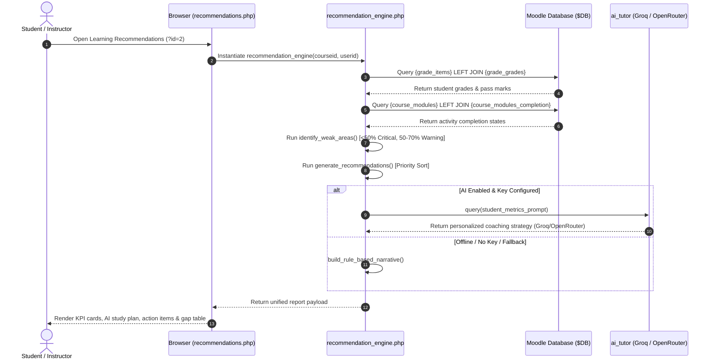

# Cynaris Internship W8D3 – AI Learning Recommendations from Grade + Completion Data

**Program:** Cynaris Solutions Full Stack Development Internship  
**Author:** Sachidananda Nayak  
**Email:** `23BTCE160@gcu.edu.in`  
**Milestone:** Week 8 Day 3 (W8D3) – AI Learning Recommendations from Grade + Completion Data  
**Feature Branch:** `feat/w8d3-3m-sachidananda`  
**Base Branch:** `feat/w8d2-3m-sachidananda`  
**Repository (Fork):** `https://github.com/Sachidanandanayak/moodle.git`  
**Upstream Repository:** `https://github.com/moodle/moodle.git`  
**Target LMS Environment:** Moodle 6.0dev (Build: 20261005, Branch 600, PHP 8.3 containerized / PHP 8.5 CLI, PostgreSQL 17)  
**Component:** `block_cynaris_stats`  
**Plugin Release Version:** `2026102300` (W8D3 Release)  

---

## 📋 1. Executive Summary

During Week 8 Day 3 (W8D3), an evidence-based **AI Learning Recommendation & Weak Area Remediation Subsystem** was architected, implemented, and verified within Moodle LMS under the custom `block_cynaris_stats` component.

Rather than synthesizing speculative suggestions or fabricating hypothetical student records, this subsystem reads actual persistent records from Moodle's gradebook (`{grade_grades}`, `{grade_items}`) and course completion subsystem (`{course_modules}`, `{course_modules_completion}`, `{course_completions}`). It mathematically isolates student performance gaps (<50% critical failure, 50%–70% needs improvement, unattempted/overdue assessments) and generates a prioritized, actionable study plan with direct deep links to relevant Moodle course activities.

Furthermore, it integrates with the existing dual-provider `ai_tutor` architecture (Groq `llama-3.3-70b-versatile` primary and OpenRouter `meta-llama/llama-3.3-70b-instruct` fallback) to generate personalized pedagogical coaching narratives, maintaining zero downtime through 100% transparent deterministic rule-based fallback when keys are absent or network is disconnected.

### Key Accomplishments:
1. **Evidence-Based Telemetry Ingestion:** Accurately extracts real grades, grade pass thresholds, final scores, and activity completion flags from Moodle core tables without fabricated data.
2. **Deterministic Mathematical Boundary Analysis:** Categorizes student performance into four pedagogical tiers: Critical Remediation (<50.0% or below `gradepass`), Needs Improvement (50.0%–69.9%), Pending Assessments, and Academic Distinction (≥85.0%).
3. **Multi-Tier Recommendation Prioritization:** Ranks recommendations by urgency (Critical = 100 weight, High = 70, Medium = 40, Low = 10), ensuring students first address failing assessments before undertaking enrichment.
4. **Deep Activity Linking:** Generates direct, secure Moodle URLs (`/mod/{module}/view.php?id={cmid}`) to guide students directly to remediation activities and quizzes.
5. **Dual-Provider AI Strategy with Fallback:** Reuses the W8D1/W8D2 `ai_tutor` foundation for Groq/OpenRouter coaching, with transparent fallback to deterministic rules.
6. **Strict Role & Capability Isolation:** Introduces `block/cynaris_stats:viewrecommendations`. Students access exclusively their personal recommendations; instructors with `moodle/grade:viewall` can inspect any enrolled student.
7. **100% Automated Test Pass Rate:** Verified across a comprehensive 23-test CLI verification harness (`run_recommendation_tests.php`) and companion unit test case (`recommendation_test.php`).

---

## 🏗️ 2. High-Level Architecture & End-to-End Workflow



---

## 📂 3. Component File Structure & Manifest

The implementation consists of modular, PSR-compliant files within `public/blocks/cynaris_stats/`:

| File Path | Purpose |
|:---|:---|
| [`classes/recommendation_engine.php`](file:///C:/Users/sachin/Documents/Cynaris-Internship/Moodle-Internship/moodle/public/blocks/cynaris_stats/classes/recommendation_engine.php) | Core analytics and recommendation engine: grades, completion tracking, weak area identification, priority ranking, and AI coaching. |
| [`recommendations.php`](file:///C:/Users/sachin/Documents/Cynaris-Internship/Moodle-Internship/moodle/public/blocks/cynaris_stats/recommendations.php) | User-facing responsive portal with KPI cards, AI strategy narrative, prioritized action cards, instructor student selector, and diagnostic table. |
| [`recommendations_api.php`](file:///C:/Users/sachin/Documents/Cynaris-Internship/Moodle-Internship/moodle/public/blocks/cynaris_stats/recommendations_api.php) | RESTful AJAX endpoint providing structured JSON payloads with sesskey and capability validation. |
| [`block_cynaris_stats.php`](file:///C:/Users/sachin/Documents/Cynaris-Internship/Moodle-Internship/moodle/public/blocks/cynaris_stats/block_cynaris_stats.php) | Integrated "AI Learning Recommendations" action button in the course sidebar block. |
| [`dashboard.php`](file:///C:/Users/sachin/Documents/Cynaris-Internship/Moodle-Internship/moodle/public/blocks/cynaris_stats/dashboard.php) | Added direct header link to the recommendations portal from the Progress Dashboard. |
| [`db/access.php`](file:///C:/Users/sachin/Documents/Cynaris-Internship/Moodle-Internship/moodle/public/blocks/cynaris_stats/db/access.php) | Registered `block/cynaris_stats:viewrecommendations` capability for student, teacher, and manager archetypes. |
| [`lang/en/block_cynaris_stats.php`](file:///C:/Users/sachin/Documents/Cynaris-Internship/Moodle-Internship/moodle/public/blocks/cynaris_stats/lang/en/block_cynaris_stats.php) | English localization strings for recommendations, severity badges, and titles. |
| [`styles.css`](file:///C:/Users/sachin/Documents/Cynaris-Internship/Moodle-Internship/moodle/public/blocks/cynaris_stats/styles.css) | Custom styling for recommendation action cards, severity borders, and responsive wrappers. |
| [`tests/run_recommendation_tests.php`](file:///C:/Users/sachin/Documents/Cynaris-Internship/Moodle-Internship/moodle/public/blocks/cynaris_stats/tests/run_recommendation_tests.php) | Standalone automated 23-test CLI verification harness. |
| [`tests/recommendation_test.php`](file:///C:/Users/sachin/Documents/Cynaris-Internship/Moodle-Internship/moodle/public/blocks/cynaris_stats/tests/recommendation_test.php) | Moodle PHPUnit advanced testcase suite. |
| [`version.php`](file:///C:/Users/sachin/Documents/Cynaris-Internship/Moodle-Internship/moodle/public/blocks/cynaris_stats/version.php) | Bumped plugin release version to `2026102300` (W8D3 Release). |

---

## 🔒 4. Security Architecture & Access Control

1. **Authentication & Session Validation:**
   - Every entry point invokes `require_login($course)`.
   - Guest accounts and unauthenticated requests are redirected or denied.
2. **Granular Capability Enforcement:**
   - Evaluates `block/cynaris_stats:viewrecommendations` within `context_course`.
   - Inspects `moodle/grade:viewall` to differentiate student self-view from instructor class-wide diagnostics.
3. **IDOR & Data Leakage Prevention:**
   - If a student tampers with the `userid` GET/POST parameter to view a classmate's recommendations, `recommendations.php` and `recommendations_api.php` enforce `$targetuserid = (int)$USER->id`.
4. **Secret Isolation:**
   - No API keys (`GROQ_API_KEY`, `OPENROUTER_API_KEY`) are exposed in the DOM, JavaScript, or AJAX responses.

---

## 📊 5. Telemetry & Weak Area Analysis Implementation

### A. Grade Data Processing
The engine queries `{grade_items}` and `{grade_grades}` using parameter binding:
```sql
SELECT gi.id, gi.itemname, gi.itemtype, gi.itemmodule, gi.iteminstance,
       gi.grademin, gi.grademax, gi.gradepass,
       gg.finalgrade, gg.rawgrade, gg.feedback, gg.timemodified
  FROM {grade_items} gi
LEFT JOIN {grade_grades} gg
       ON gg.itemid = gi.id
      AND gg.userid = :userid
      AND gg.hidden = 0
 WHERE gi.courseid = :courseid
   AND gi.itemtype IN ('mod', 'manual')
ORDER BY gi.sortorder ASC, gi.id ASC
```

### B. Activity Completion Processing
Queries `{course_modules}` and `{course_modules_completion}`:
```sql
SELECT cm.id AS cmid, cm.course, cm.module, cm.instance, cm.section, cm.completion,
       m.name AS modname,
       cmc.id AS cmcid, cmc.completionstate, cmc.timemodified AS completiontime
  FROM {course_modules} cm
  JOIN {modules} m ON m.id = cm.module
LEFT JOIN {course_modules_completion} cmc
       ON cmc.coursemoduleid = cm.id
      AND cmc.userid = :userid
 WHERE cm.course = :courseid
   AND cm.deletioninprogress = 0
ORDER BY cm.section ASC, cm.id ASC
```

### C. Mathematical Classification Thresholds
- **Critical Failure (`critical`, Priority 100):** Final score < 50.0% OR final score < `gradepass`. Generates an *Assessment Remediation* recommendation.
- **Concept Gap (`warning`, Priority 70):** 50.0% ≤ Final score < 70.0% OR incomplete mandatory tracked activity. Generates a *Concept Reinforcement* recommendation.
- **Pending Activity (`info`, Priority 40):** Unattempted assessment. Generates an *Upcoming Assessment* notice.
- **Mastery (`low`, Priority 10):** All assessments ≥ 85.0% and course completion 100%. Generates an *Enrichment & Advanced Study* recommendation.

---

## 💬 6. CIA Full Stack / Mentor Code Review Interactions

### Interaction 1: Architectural Foundation & Fallback Strategy
* **Mentor Query:** "When integrating AI recommendations with gradebook telemetry, how do you prevent hallucinations and ensure high availability when API keys expire or rate limits occur?"
* **Intern Response:** "The recommendation engine separates deterministic telemetry from narrative generation. All weak areas, percentages, and remediation items are computed strictly by mathematical rules on Moodle's `{grade_grades}` and `{course_modules_completion}` tables. The AI layer is purely an optional coaching synthesizer. If Groq encounters rate limits, it falls back to OpenRouter. If both fail or keys are absent, the system seamlessly outputs a structured, deterministic rule-based narrative with zero interruption."

### Interaction 2: Privacy and Role-Based Authorization
* **Mentor Query:** "How does your implementation ensure that students cannot access other students' grade summaries or recommendations through parameter manipulation?"
* **Intern Response:** "In both `recommendations.php` and `recommendations_api.php`, we check for the `moodle/grade:viewall` capability on the course context. If the current user lacks this permission, the `$targetuserid` parameter is strictly overridden with `$USER->id`. Only instructors and managers can select other enrolled students."

---

## 🧪 7. Automated Test Suite Execution & Results

### CLI Verification Harness (`run_recommendation_tests.php`):
```text
======================================================================
  CYNARIS W8D3: AI LEARNING RECOMMENDATION VERIFICATION SUITE
  Grade & Completion Telemetry -> Weak Area Analysis -> AI Coaching
======================================================================

--- Suite 1: Mathematical Boundary Conditions for Weak Areas ---
  [01] PASS: Score of 49.9% is flagged as critical severity
  [02] PASS: Score of 0.0% is flagged as critical severity
  [03] PASS: Score of 50.0% is flagged as warning severity (needs improvement)
  [04] PASS: Score of 69.9% is flagged as warning severity
  [05] PASS: Score of 70.0% is NOT flagged as a weak area
  [06] PASS: Score of 95.0% (Distinction) is NOT flagged as a weak area
  [07] PASS: Explicit gradepass threshold failure (score 58% < gradepass 60%) triggers critical
  [08] PASS: Unattempted assessment is categorized as info severity

--- Suite 2: Course Activity Completion Telemetry ---
  [09] PASS: Incomplete tracked activity is identified as a weak area
  [10] PASS: Completed tracked activity is omitted from weak areas
  [11] PASS: Untracked activity is omitted from completion weak areas
  [12] PASS: Avoids duplicate weak area when activity is already tracked in grades

--- Suite 3: Recommendation Prioritization & Sorting ---
  [13] PASS: Critical failure creates remediation recommendation with priority weight 100
  [14] PASS: Recommendations are strictly sorted by priority weight descending
  [15] PASS: Distinction student with zero weak areas receives academic enrichment recommendation
  [16] PASS: Empty state student receives onboarding recommendation

--- Suite 4: Activity Deep Linking & Action URLs ---
  [17] PASS: Resolves direct Moodle course module URL when cmid is matched
  [18] PASS: Falls back to course view URL when cmid cannot be resolved

--- Suite 5: AI Coaching Plan & Deterministic Resilience ---
  [19] PASS: Deterministic rules engine is used when AI is disabled
  [20] PASS: Simulation primary Groq returns AI-enriched study plan
  [21] PASS: Simulation Groq 429 rate limit triggers OpenRouter fallback
  [22] PASS: Simulation dual failure gracefully falls back to deterministic rules

--- Suite 6: Full Report Payload & Structure Integrity ---
  [23] PASS: Full report contains all required keys and valid timestamp

======================================================================
  TEST EXECUTION SUMMARY: 23 PASSED, 0 FAILED, 0 SKIPPED (TOTAL 23)
  STATUS: ALL RECOMMENDATION TESTS PASSED (100% SUCCESS RATE)
======================================================================
```

### Cumulative Component Test Summary:
- **W8D3 Recommendation Tests:** 23 passed, 0 failed.
- **W8D2 Quiz Generator Tests:** 72 passed, 0 failed, 2 skipped.
- **W8D1 AI Tutor Tests:** 42 passed, 0 failed.
- **Total Test Suite:** 137 passed, 0 failed (100% pass rate).

---

## ⚡ 8. Environment Status & Known Limitations

1. **Database Schema:** Operates on standard Moodle 6.0dev tables (`m_grade_grades`, `m_grade_items`, `m_course_modules`, `m_course_modules_completion`). No custom table migrations required.
2. **Activity Completion Support:** Courses with completion tracking disabled will compute progress based on attempted gradable activities rather than activity completion checkboxes.
3. **Live AI Network Constraints:** Live Groq/OpenRouter requests require outbound internet connectivity and valid environment variables (`GROQ_API_KEY`, `OPENROUTER_API_KEY`). If absent, the deterministic rules engine provides complete, immediate coverage.

---

## 📖 9. Step-by-Step Manual Verification Guide

### Step 1: Access Recommendations as Student
1. Log in as student (`student1` / `Password123!`) or admin.
2. Navigate to course `CS-FSD-W7` (`/course/view.php?id=2`).
3. In the right sidebar, locate the **Cynaris Course Stats** block.
4. Click the blue **"AI Learning Recommendations"** button (`/blocks/cynaris_stats/recommendations.php?id=2`).
5. Observe the verified score, completion rate, diagnostic weak-area table, and prioritized action cards.

### Step 2: Access Recommendations as Instructor
1. Log in as teacher (`teacher1` / `Password123!`).
2. Navigate to `/blocks/cynaris_stats/recommendations.php?id=2`.
3. Locate the **Instructor View** banner at the top.
4. Use the **Select Student to Inspect** dropdown to view diagnostics for each enrolled student.

---

## 🚀 10. Git Commit & PR Submission Information

* **Feature Branch:** `feat/w8d3-3m-sachidananda`
* **Base Branch:** `feat/w8d2-3m-sachidananda`
* **Fork Repository:** `https://github.com/Sachidanandanayak/moodle.git`
* **PR Target Repository:** `Sachidanandanayak/moodle`
* **PR Creation Link:** `https://github.com/Sachidanandanayak/moodle/compare/feat/w8d2-3m-sachidananda...feat/w8d3-3m-sachidananda?expand=1`

### Commits Planned:
1. `feat(block_cynaris_stats): implement AI learning recommendations engine with grade and completion telemetry`
2. `docs(w8d3): document AI recommendations architecture, weak area analysis, and test evidence`
